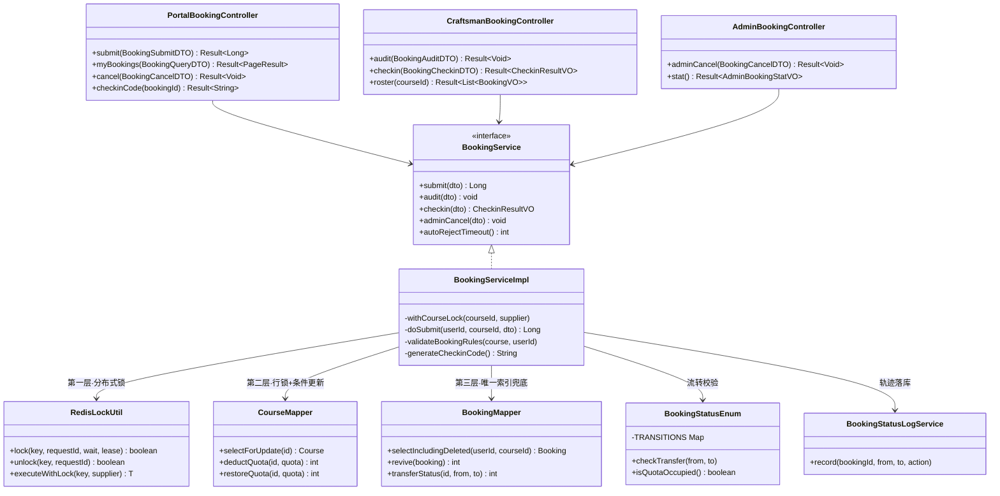
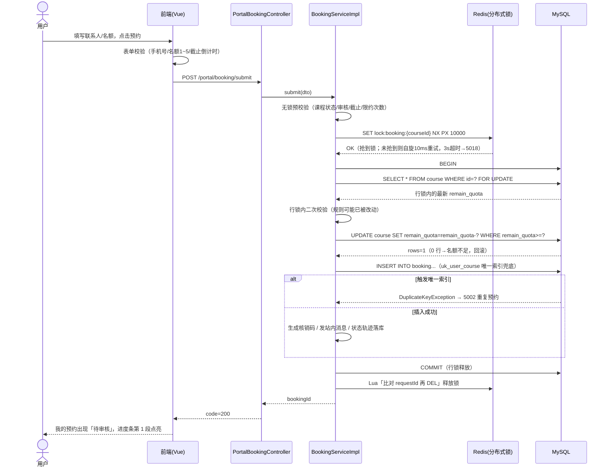
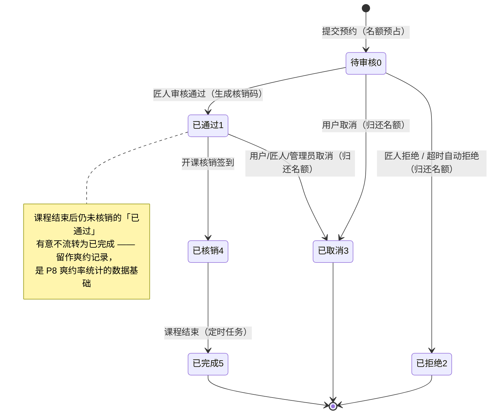

# 11 · P10 质量保障与交付报告

> 非遗手工艺品展示与预约体验平台 · 阶段 P10
> 作者：李明峰 23100025 · 2026-09-18

---

## 一、结果总览

| 项 | 结果 |
|---|---|
| 单元测试（5 类核心逻辑） | **62 / 62 通过**（`mvn test`，JUnit 5） |
| Postman 接口集合 | **16 分组 / 211 接口**（由控制器源码自动生成，导入即用） |
| JMeter 压测脚本 | 商品列表读 + 预约提交写（`jmeter/` 目录） |
| 压测实测（读） | 50 并发 × 4 次：**863 req/s，p95 59ms，错误率 0** |
| 压测实测（写·题眼） | **100 并发抢 10 名额：恰好 10 成功、90 个返回 5006、`remain_quota` 归 0、无超卖无重复** |
| 全局自查（规划书第九节 8 条） | **30 / 30 通过** |
| 交付文档 | README.md（含答辩演示脚本）、CHANGELOG.md |

---

## 二、单元测试（62 用例）

| 测试类 | 用例 | 覆盖内容 |
|---|---|---|
| `JwtUtilTest` | 8 | access/refresh 双 Token 生成与解析、过期→1005、伪造/篡改/换密钥→1004、Bearer 剥离、剩余有效期（黑名单 TTL 依据） |
| `CouponStrategyTest` | 13 | 满减（门槛边界、封顶 min(券面,订单)、脏数据不抵扣）、折扣（HALF_UP 舍入、rate 非法）、门槛判定、展示文案、工厂路由/重复注册快速失败 |
| `BookingStatusEnumTest` | 23 | 流转表 6 条合法路径 + **12 条非法跳转全部拒绝（验收重点）**、终态判定、名额占用口径 {0,1,4,5}、提示带状态名、code↔枚举 |
| `RedisLockUtilTest` | 9 | NX 互斥、Lua 原子释放（非持有者不能误删）、自旋重试、超时放弃、模板方法 finally 解锁、抢不到锁抛 5018 且不执行业务 |
| `OrderAmountTest` | 9 | 小计=单价×数量（HALF_UP 进位）、失效项标记、总额−券抵扣=实付、抵扣封顶实付不为负、订单状态机合法/非法流转 |

运行方式：

```powershell
cd heritage-server
mvn test    # Tests run: 62, Failures: 0, Errors: 0
```

> 状态机非法跳转用例是验收标准明确要求的：例如「待审核→已核销」「已通过→已完成」
> （未到场是爽约不是完成）、「已核销→已取消」（人已到场名额已消耗）等 12 条路径全部断言被拒。

---

## 三、Postman 集合与 JMeter 压测

### 3.1 Postman（`postman/非遗平台接口集合.postman_collection.json`）

- 由 `tools/_gen_postman.py` 扫描全部 41 个控制器自动生成，与代码**同源**（211 个端点逐一比对过源码 `@Mapping` 总数，仅健康检查 Ping 不入集合）
- 16 个业务分组（认证/门户/商品/购物车/订单/课程/匠人/预约/优惠券/评价/收藏/消息/内容/统计/日志…）
- 关键端点预置示例 body（登录、提交预约、审核、核销、强制取消、规则配置等）；集合变量 `base_url`、`token`

### 3.2 JMeter（`jmeter/`）

| 脚本 | 模型 | 结果说明 |
|---|---|---|
| `商品列表压测.jmx` | 200 线程 30s 坡道，持续 60s，GET `/portal/goods/list` | 等价 Python 实测：50 并发 200 请求 **863 req/s / p95 59ms / 0 错误**（列表走 Redis 缓存） |
| `预约提交压测.jmx` | 100 线程一次性并发（ramp=0），每线程独立账号先登录再提交同一门课 | 等价 Python 实测（下表）；JMX 内置断言：业务码只允许 200/5006/5002/5018，出现其他码即失败 |

**预约提交 100 并发抢 10 名额实测数据**（等价于 JMeter 运行，脚本 `tools/_p10stress.py`）：

| 指标 | 数值 |
|---|---|
| 响应分位 | p50 805ms / p95 1501ms / max 1562ms（写接口有锁排队，属预期） |
| 状态码分布 | `200 × 10`，`5006（名额不足）× 90` |
| 成功数 | **恰好 10 = 名额数（不超卖）** |
| 数据库校验 | `remain_quota = 0`；占名额预约数 = 10 |
| 结论 | 三层防超卖在 100 并发下**零超卖、零重复** |

> 跑前跑后各执行一次 `schema.sql` 恢复出厂数据，压测不污染演示库。

---

## 四、全局自查（对照规划书第九节 8 条验收标准）

| # | 标准 | 结论 | 证据 |
|---|---|---|---|
| 1 | 三端可登录、权限隔离正确 | ✅ | 30 项断言：普通用户/匠人访问 `/admin/**`（读+写）均 403(1003)；访问匠人端 403；三角色 profile 正常 |
| 2 | 下单全流程可走通 | ✅ | 加购→结算预览（总额=实付）→创建→支付→匠人发货→确认收货→评价，10 步全绿（订单 HO20260918…286498） |
| 3 | 预约并发 100 抢 10 不超卖不重复 | ✅ | 恰好 10 成功、90 个 5006、`remain_quota` 归 0（见第三节） |
| 4 | 更新商品后缓存清除 | ✅ | 匠人改 subtitle → 立即 GET 商品详情返回新值（无旧缓存） |
| 5 | 11 类图表真实数据 | ✅ | 13 个 `/admin/stat/*` 端点全部 200，总览 8 项核心指标非空 |
| 6 | 操作日志记录操作人/IP/耗时 | ✅ | 日志记录含 `operator / ip / costMs / costText` 字段，本次自查的写操作已落 2 条 |
| 7 | Excel 导出可打开且数据正确 | ✅ | 商品导出 5992 字节、PK 头、22 数据行 |
| 8 | 一键启动 + README | ✅ | README 含完整启动步骤与演示账号；健康检查在线 |

**自查脚本**：`tools/_p10check.py`（输出 `tools/_p10check_out.txt`），跑后已恢复出厂数据。

---

## 五、预约主题材（论文「系统实现」章节）

### 5.1 预约模块类图



### 5.2 预约提交全流程时序图



### 5.3 预约状态机图



**状态流转表**（与 `BookingStatusEnum.TRANSITIONS` 一致，单元测试逐条覆盖）：

| 当前状态 | 允许流转到 | 归还名额 | 备注 |
|---|---|---|---|
| 待审核(0) | 已通过(1) / 已拒绝(2) / 已取消(3) | 仅 2/3 归还 | 提交时即预占名额 |
| 已通过(1) | 已核销(4) / 已取消(3) | 仅 3 归还 | 通过时生成核销码 |
| 已核销(4) | 已完成(5) | — | 课程结束后由定时任务推进 |
| 已拒绝(2) | 终态 | 已归还 | cancel_by=1 匠人 / 4 系统 |
| 已取消(3) | 终态 | 已归还 | cancel_by=0 用户 / 2 匠人 / 3 管理员 |
| 已完成(5) | 终态 | — | 真实到场 |

非法跳转（如 0→4、1→5、3→1、4→3）由 `BookingStatusEnum.checkTransfer` 统一拒绝，返回 5010 并携带当前状态名。

### 5.4 三层防超卖核心代码片段

**第一层 · Redis 分布式锁**（`RedisLockUtil`，同一课程同一时刻只放一个请求进入校验）：

```java
// 加锁：SET key requestId NX PX leaseMillis —— NX 互斥，PX 宕机自动释放
public boolean tryLock(String key, String requestId, long leaseMillis) {
    Boolean ok = redisTemplate.opsForValue()
            .setIfAbsent(key, requestId, Duration.ofMillis(leaseMillis));
    return Boolean.TRUE.equals(ok);   // Redis 超时抖动返回 null 也视为失败
}

// 释放：Lua「先比对 requestId 再 DEL」—— 保证判断+删除原子，不误删他人的锁
private static final RedisScript<Long> UNLOCK_SCRIPT = new DefaultRedisScript<>(
        "if redis.call('get', KEYS[1]) == ARGV[1] then " +
        "  return redis.call('del', KEYS[1]) else return 0 end", Long.class);

// 模板方法：业务成功或抛异常都在 finally 释放锁
public <T> T executeWithLock(String key, Supplier<T> supplier, ErrorCode busyCode) {
    String requestId = UUID.randomUUID().toString();
    if (!lock(key, requestId, DEFAULT_WAIT_MILLIS, DEFAULT_LEASE_MILLIS)) {
        throw new BusinessException(busyCode);      // 自旋 3s 仍抢不到 → 5018
    }
    try {
        return supplier.get();
    } finally {
        unlock(key, requestId);
    }
}
```

**第二层 · 数据库行锁 + 原子条件更新**（`BookingServiceImpl.doSubmit`，事务内）：

```java
// ① FOR UPDATE 行锁：并发请求在此排队，读到的必是上一事务扣完后的值
@Select("SELECT * FROM course WHERE id = #{id} AND deleted = 0 FOR UPDATE")
Course selectForUpdate(@Param("id") Long id);

// ② 判断+扣减合成一条原子 SQL：remain_quota >= quota 不满足则 0 行
@Update("UPDATE course SET remain_quota = remain_quota - #{quota}, "
      + "booking_count = booking_count + #{quota}, update_time = NOW() "
      + "WHERE id = #{id} AND deleted = 0 AND remain_quota >= #{quota}")
int deductQuota(@Param("id") Long id, @Param("quota") int quota);

// ③ 业务层：0 行即名额已被抢完 → 抛异常回滚整单
int rows = courseMapper.deductQuota(courseId, quota);
BusinessException.throwIf(rows == 0, ErrorCode.BOOKING_QUOTA_NOT_ENOUGH);
```

**第三层 · 唯一索引兜底**（同一用户同一课程只能有一条预约记录，含逻辑删除的行）：

```java
try {
    bookingMapper.insert(booking);
} catch (DuplicateKeyException e) {
    // uk_user_course(user_id, course_id) 把并发重复提交挡在这里
    throw new BusinessException(ErrorCode.BOOKING_DUPLICATE);
}
```

**归还路径的自我防护**（拒绝/用户取消/管理员取消/系统超时四条路径共用）：

```java
// LEAST(total_quota, ...) 兜住上限：即使并发重试导致重复归还，
// 剩余名额也绝不会超过总名额 —— 不会凭空「多出名额」卖超
@Update("UPDATE course SET remain_quota = LEAST(total_quota, remain_quota + #{quota}), "
      + "booking_count = GREATEST(booking_count - #{quota}, 0), update_time = NOW() "
      + "WHERE id = #{id}")
int restoreQuota(@Param("id") Long id, @Param("quota") int quota);
```

**验证结果**：100 并发抢 10 名额 → 恰好 10 个 200、90 个 5006、`remain_quota=0`、无重复预约（`uk_user_course` 未被触发冲突以外的路径）。

---

## 六、遗留与后续方向

- 可视化接口未加缓存（十万级数据量建议加 5 分钟缓存）；MAU 靠行为表反推
- 资讯富文本未做 XSS 过滤（开放匠人投稿前必须补）
- 导出条数上限 5000/1000 条（防内存拖垮，可改流式导出）
- 可选增强（论文加分项）：三种防超卖方案的对比实验、直查 MySQL vs Redis 缓存的性能对比
