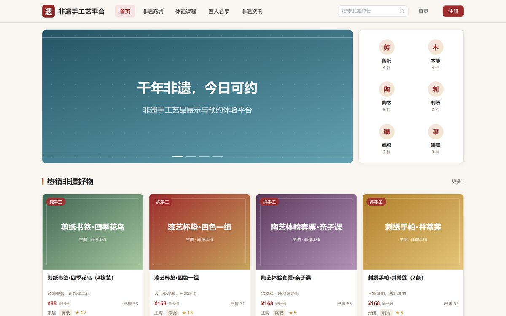
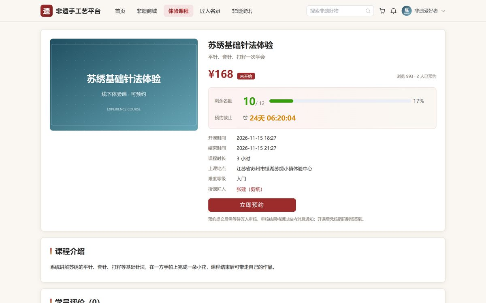
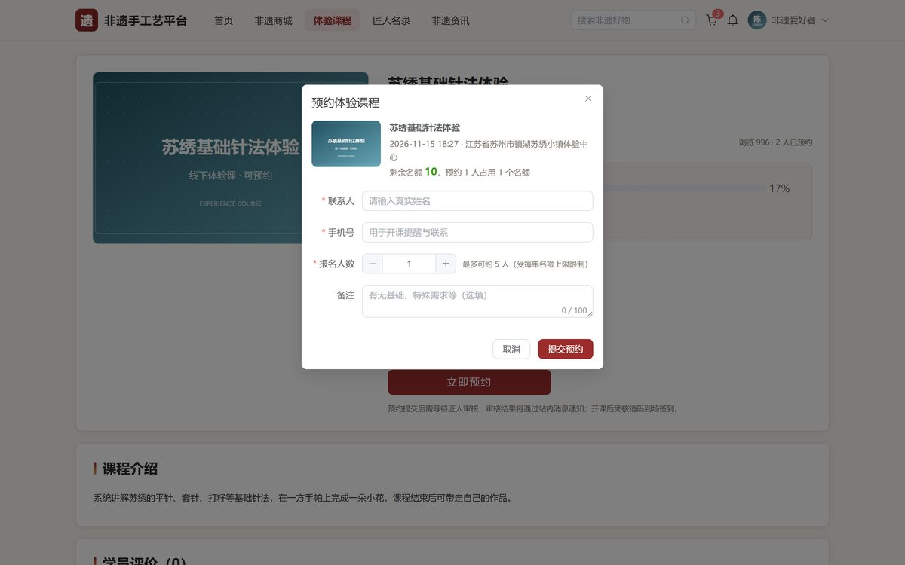
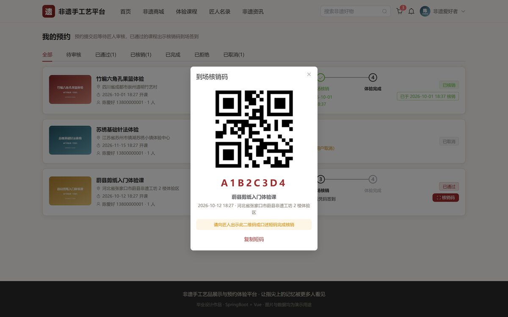
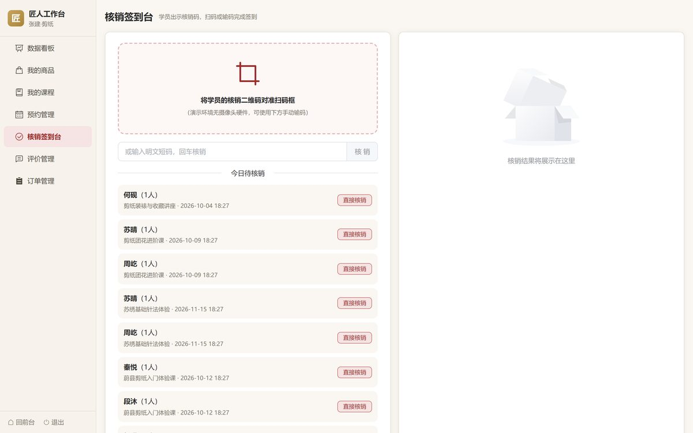
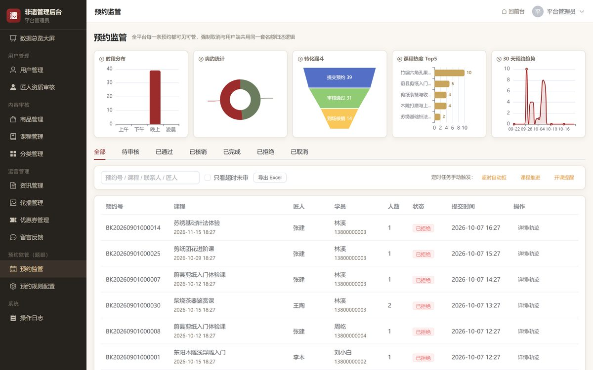
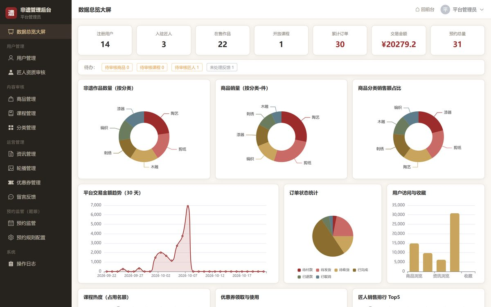

# 非遗手工艺品展示与预约体验平台

> 毕业设计 · SpringBoot 3.2 + Vue 3.4 前后端分离项目 · 作者：李明峰



<p align="center">
  
  
  <br/>
  
  
  <br/>
  
  
</p>

## 一、项目简介

面向「非物质文化遗产手工艺品」的展示、电商与**线下体验预约**一体化平台，包含三个子系统：

| 子系统 | 面向 | 核心能力 |
|---|---|---|
| 用户端（portal） | 普通用户 | 商品浏览/搜索、购物车、下单支付、**课程预约（题眼）**、资讯、优惠券、评价、个人中心 |
| 匠人端（craftsman） | 非遗匠人 | 商品/课程管理、**预约审核与核销签到**、订单发货、评价管理、数据看板 |
| 管理端（admin） | 平台管理员 | 用户与匠人资质管理、内容审核、**全平台预约监管与统计**、规则配置、11 类数据图表、Excel 导出、操作日志 |

**预约是本课题的题眼**：用户端「预约」→ 匠人端「审核与核销」→ 管理端「监管与统计」三端闭环，
并发防超卖采用**三层防护**（Redis 分布式锁 → 数据库行锁+条件更新 → 唯一索引兜底）。

## 二、技术栈

| 层 | 组件 | 版本 |
|---|---|---|
| 后端 | JDK / SpringBoot / MyBatis-Plus | 17 / 3.2.5 / 3.5.7 |
| 存储 | MySQL / Redis | 8.0 / 7 |
| 认证 | JWT 双 Token（access 2h + refresh 7d）+ Redis 黑名单 | JJWT 0.12.6 |
| 文档 | Knife4j（OpenAPI3） | 4.x |
| 前端 | Vue / Vite / Element Plus / Pinia / ECharts | 3.4 / 5 / — / — / — |
| 测试 | JUnit 5 / JMeter / Postman | 5.10 / 5.6 / v2.1 |

## 三、环境要求

- JDK 17（Temurin）、Maven 3.9
- MySQL 8（本项目使用 **3307** 端口实例，库名 `heritage`）
- Redis 7（127.0.0.1:6379，无密码）
- Node.js 20+（前端）
- 初始化数据：`sql/schema.sql`（建库建表 + 出厂演示数据，可重复执行恢复出厂）

> 数据库账号、Redis、上传目录等本地配置见 `heritage-server/src/main/resources/application.yml`，按自己环境修改即可。

## 四、启动步骤（约 10 分钟）

```powershell
# 1. 启动 MySQL(3307) 与 Redis(6379)

# 2. 初始化 / 恢复数据库
mysql -h 127.0.0.1 -P 3307 -uroot -p --default-character-set=utf8mb4 < sql/schema.sql

# 3. 启动后端（或在 IDEA 中运行 HeritageApplication）
cd heritage-server
mvn spring-boot:run          # 端口 8080

# 4. 启动前端
cd ../heritage-web
npm install
npm run dev                  # 端口 5173，/api 已代理到 8080
```

- 健康检查：<http://127.0.0.1:8080/api/portal/ping>
- 接口文档：<http://127.0.0.1:8080/api/doc.html>（Knife4j）
- 前端首页：<http://127.0.0.1:5173>

### 演示账号（密码统一 `123456`）

| 账号 | 角色 | 用途 |
|---|---|---|
| admin | 管理员 | 管理端全部功能 |
| user01 / user02 | 普通用户 | 用户端 |
| zhangjian / limu / wangtao | 匠人（剪纸/木雕/陶艺） | 匠人端 |

## 五、预约主线演示脚本（约 5 分钟）

> 演示前先执行 `sql/schema.sql` 恢复出厂数据；账号密码见上表。

| 步 | 端 / 账号 | 操作 | 预期 |
|---|---|---|---|
| 1 | 用户端 · user01 | 首页 → 顶部「体验课程」→ 进入任意课程详情 | 名额进度条醒目；开课前可见「距预约截止 X 天 X:XX:XX」实时倒计时 |
| 2 | 用户端 · user01 | 填写联系人/手机号/名额 → 提交预约 | 提示「预约已提交，等待匠人审核」；我的预约出现「待审核」记录，四段进度条停在第 1 段 |
| 3 | 匠人端 · limu | 预约管理 → 该条记录「通过」 | 状态变「已通过」；用户站内消息 +1 |
| 4 | 用户端 · user01 | 我的预约 → 打开核销码 | 二维码大图 + 明文短码 |
| 5 | 匠人端 · limu | 核销签到台 → 输入短码（或扫码）→ 确认核销 | 结果卡显示学员/名额/核销方式；状态变「已核销」 |
| 6 | 用户端 · user01 | 再次查看该预约 | 进度条到「已核销」；课程结束后由定时任务推进为「已完成」 |
| 7 | 管理端 · admin | 预约监管 → 统计图表 + 已核销 Tab | 时段分布/爽约率/转化漏斗/课程热度/30 天趋势 5 项图表可查到本次数据 |
| 8 | 管理端 · admin | 预约规则配置 → 把提前预约小时数改大 → 用户端再约 | 下一个请求即被拦截（热生效，无需重启） |
| 9 | （可选）管理端 · admin | 预约监管 → 强制取消一条「已通过」 | 名额归还（课程 remain_quota +1）、状态轨迹落库、用户收到通知 |

**并发不超卖验证**：见第六节压测说明与 `jmeter/预约提交压测.jmx`（100 并发抢 10 名额：恰好 10 成功，90 个返回 5004 名额不足，`remain_quota` 恰好归 0）。

## 六、测试与质量保障

| 项 | 位置 | 结果 |
|---|---|---|
| 单元测试（5 类核心逻辑 62 用例） | `heritage-server/src/test/java/...` | `mvn test` 62/62 通过（JwtUtil / 优惠券策略 / 预约状态机 / Redis 分布式锁 / 订单金额） |
| 接口集合 | `postman/非遗平台接口集合.postman_collection.json` | 16 分组 / 211 接口（由控制器源码生成，导入即用） |
| JMeter 压测脚本 | `jmeter/商品列表压测.jmx`、`jmeter/预约提交压测.jmx` | 读 50 并发 863 req/s、p95 59ms、错误率 0；写 100 并发抢 10 名额：恰好 10 成功、90 个返回 5006 名额不足、remain_quota 归 0 |
| 分阶段联调报告 | `03~11-*报告.md` | P2–P10 每阶段全量 HTTP 断言（23~149 项）全绿 |

## 七、目录结构

```
非遗平台项目/
├── heritage-server/        # 后端（Maven 单体，按 module 分包）
│   └── src/main/java/com/lmf/heritage/
│       ├── common/         # 统一返回 / 错误码 / 异常 / 常量
│       ├── security/       # JWT 双 Token、鉴权拦截、UserContext
│       └── module/         # 20 个业务模块（booking 为题眼）
├── heritage-web/           # 前端（Vue3 + Vite，portal/craftsman/admin 三端路由）
├── sql/schema.sql          # 建表 + 出厂演示数据（27 张表）
├── jmeter/                 # 压测脚本
├── postman/                # Postman 集合
├── docs/screenshots/       # 项目截图
└── 00~12-*.md              # 规划书、各阶段联调报告、答辩指南
```

## 八、可以深入聊的技术点

- **并发防超卖**：为什么是「分布式锁 + 行锁 + 唯一索引」三层，而不是单一方案？锁的粒度、租约、失效兜底怎么设计？
- **JWT 双 Token**：access 短效 + refresh 无感续期，注销如何让 Token 立刻失效？
- **预约状态机**：六态流转与取消回滚，如何保证名额不虚占、不漏还？
- **缓存一致性**：为什么「先更新数据库再删缓存」，空值缓存与差异化过期解决了什么？
- **可观测性**：操作日志、Excel 导出、11 类统计图表的数据口径怎么定？